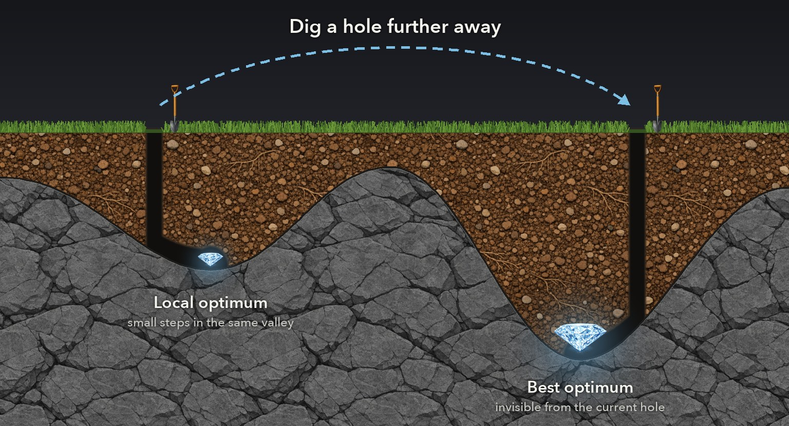
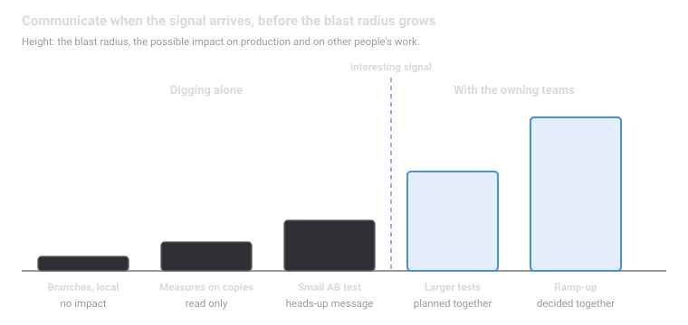
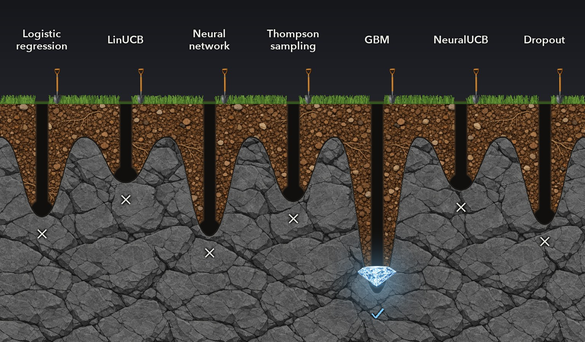
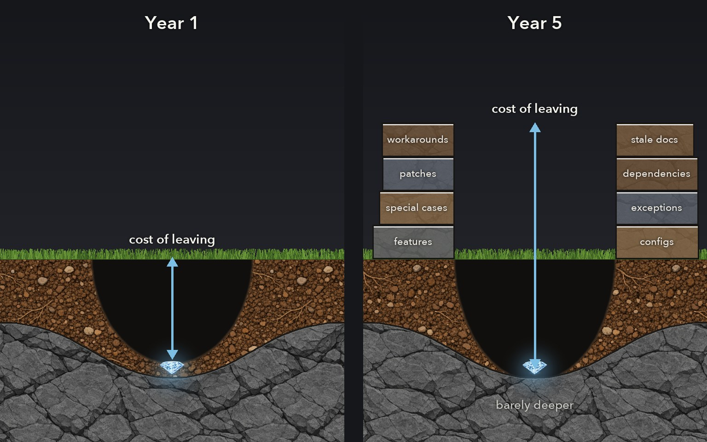
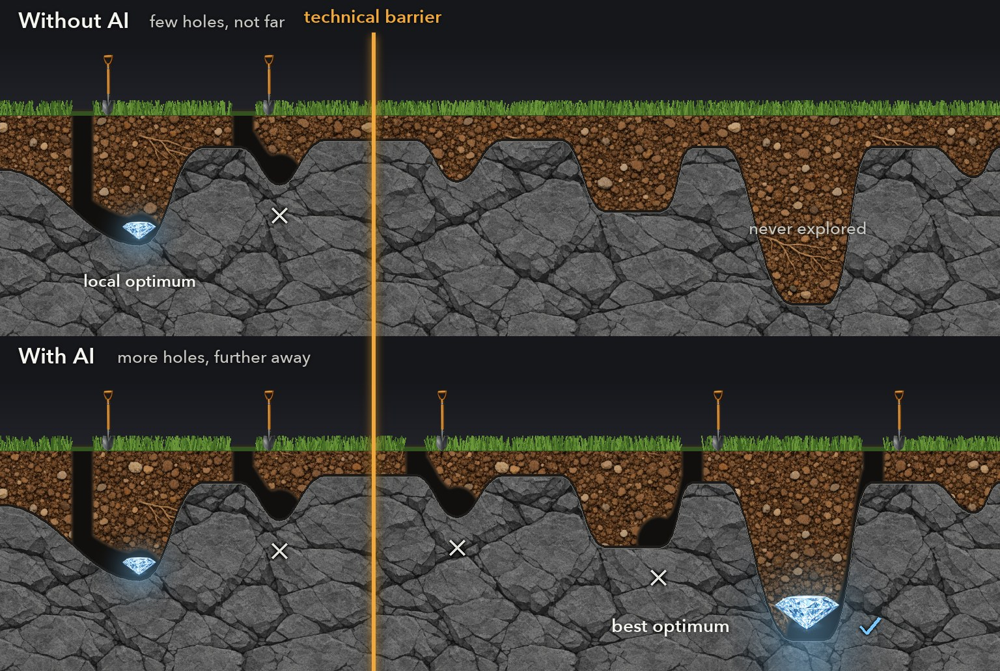

In engineering, most of our time goes into improving what already exists, one small step at a time. Yet the real gains often lie elsewhere, in optima you cannot see from the bottom of the hole you are digging. And you don't need to be an expert to spot them.

# Everything is an optimization problem

Any problem can be seen as a function to optimize, from picking a data structure to setting company strategy. This is not a metaphor: it is a reasoning tool that works at every scale.

At Equativ, all our decisions, whether technical, product, sales or marketing, ultimately act on a single quantity: the value created over time.

The problem then becomes a space with many dimensions, with a terrain of slopes and valleys.

For convenience, we will talk about minimizing a loss rather than maximizing a gain. The best solutions are then the lowest points, and looking for a better solution means digging.

# The landscape and its local optima

An organization improving what it already has is running gradient descent with small steps. It is efficient at reaching the bottom of the valley it is in, and blind to everything beyond its rim.

This terrain exists, but it is buried: all you know is the slope under your feet and the spots already probed. Digging means going to see what lies underneath. And in the current valley, you can dig for years without ever going deeper than its floor.

Most of the work done today consists of going a little deeper into the same local optimum. Each step is rational, but the whole is not necessarily so.

# Weak signals

You can tell you are in a local optimum without knowing the domain. The signals are not about technical content, but about the shape of the effort: how the system evolves, who looks after it, how it is explained.

| Signal | What it reveals |
| --- | --- |
| A stack that piles up features, special cases and hacks over the years | Small steps keep being added in the same valley instead of rethinking the shape of the problem |
| Nobody feels they own the system | Nobody has the mandate, or the wish, to look beyond the rim |
| Old or missing documentation | The original mental model is lost, and people optimize without knowing why things are the way they are |
| "We've always done it this way" as the only justification | The current position is inherited, not chosen |
| A solution picked because it is consensual or trendy | The selection criterion is no longer the objective, but comfort or image |

None of these signals proves that a better optimum exists. Together, they suggest that nobody has looked for one.

# The method: dig a hole further away

When the signals light up, improving what exists is no longer enough. You have to dig elsewhere, starting from scratch, even on a topic you don't master.

1. **Start from the need, not the solution.** Deliberately ignore how it is done today, and ask what should be done.
2. **Follow the logic.** Common sense and reasoning are the only reliable signal. Habit, authority and fashion are not.
3. **Iterate fast and drop without regret.** If the hole leads nowhere, dig another one elsewhere. After enough attempts, you almost always find something interesting.

Lacking expertise is as much an advantage as a handicap here. Experts know the bottom of their hole perfectly, and that is precisely what keeps them from climbing out.

This approach has a name in optimization: *random restart*, or simulated annealing. When gradient descent stalls, you don't refine the step size, you restart the search from another point. What is obvious for an algorithm is much less so for an organization.

# Dig quietly, then communicate

Exploring this way often means stepping into other teams' scope, and the criticism of not giving notice comes quickly. Staying quiet while digging lightly is a deliberate choice, though: there is nothing to say yet. What triggers communication is not the calendar, it is the signal.

**Dig without blast radius.** Experiments stay on branches, measurements run on copies of production data, and AB tests cover at most a fraction of a percent of traffic. Nothing is merged into other people's code, nothing is irreversible. A hole that leads nowhere gets filled back in without anyone bearing the consequences.

**Why not announce every hole.** Most holes lead nowhere. Announcing each one draws the owning team's attention and opens a debate on an idea that nothing supports yet. And effort clustering kicks in: faced with consensus, an idea without evidence dies before it has been dug.

**Informing is not asking for permission.** The criticism has some truth to it: even a 1% AB test touches production and another team's dashboards. As soon as an experiment leaves the sandbox, a short message to the owners costs little and avoids bad surprises. That message informs, it does not open a debate.

**Communicate and plan once there is a signal.** If the hole turns out to be interesting, you show up with measurements, not a hunch. Only then do you plan larger tests with the teams involved, and possibly a ramp-up. The discussion is now about numbers, and consensus becomes an ally.

# An example: Motherlode

Motherlode is the textbook case. It is an RTB call limiter rewritten from scratch starting in September 2025, by people who were not experts in the field. It sends fewer requests to DSPs for equal or higher revenue, at a much lower inference cost.

**The starting valley.** For each ad request, the RTB engine chooses which DSPs to call: every call costs network and CPU, and only the ones that bid bring revenue. The existing limiter relied on TensorFlow Serving and offline training lagging several hours behind. Its predictions had no physical unit and were compared to thresholds that could be overridden at four levels.

**The weak signals.** Even without machine learning expertise, you could see a critical, niche system, feature-rich to the point of clutter: everything entropy needs to settle in. A quick test confirmed the hunch. Disabling the limiter on a single pod clearly increased revenue in both regions tested. That result does not extrapolate, but a model meant to minimize revenue loss should not be beaten by "call everyone".

**Starting from scratch.** The reframed objective fits in one sentence: maximize RTB revenue under a call budget. Each partner gets a score with a physical meaning, the expected revenue per call:

$$
\text{score} = P(\text{bid} \mid \text{request}) \times E[\text{revenue} \mid \text{bid}]
$$

The threshold becomes interpretable too. It follows directly from the network cost of a call and the target margin: below it, calling a DSP costs more than it brings in. The model learns online, in minutes rather than hours.

**Several holes before the right one.** The path was not linear, and that is the point:

In parallel, the rewrite from PyTorch to Rust multiplied performance by 10 to 20, which made each new hole cheaper to dig.

Every abandoned lead cost little and taught a lot. A nod to the approach: Motherlode's hyperparameters are tuned by simulated annealing, the philosophy applied to itself.

**The results.** In an AB test on half of a region's traffic, Motherlode matches or beats the existing limiter's revenue while sending significantly fewer requests. In another region, revenue per request sent was noticeably higher. Inference costs a fraction of what it used to, and the expected infrastructure savings are significant.

**The price of climbing out.** In June 2026, the full rollout was nonetheless postponed. Results were uneven across DSPs, the stack was already in the middle of a migration, and investing in two limiters in parallel was deemed inefficient. This is effort clustering at work: the old optimum has its dashboards, its thresholds and its experts, and the new one has to beat it on the old one's metrics.

# Why we stay stuck

If better optima are within reach, why do so few people go looking for them? Three forces keep teams at the bottom of the same hole.

**Consensus and fashion.** Teams converge on the solutions everyone talks about. These often address only part of the need, with trade-offs nobody questions anymore. Sometimes they address no need at all and mostly please developers because they look serious. Picking the consensus means picking the hole where everyone is already digging.

**Effort clustering.** The more people in a hole, the more it attracts: tooling, hiring, careers and documentation all concentrate there. Every small step is measurable and rewarded. Exploring elsewhere is expensive at first, often fails, and those failures are visible.

**Entropy.** A living system accumulates complexity. Every patch raises the walls of the hole, and with them the cost of getting out. Over time, the local optimum becomes a trap, not because it is good, but because leaving it gets more and more expensive.

The floor gains a few inches, the walls gain feet. That is why an old system seems indispensable: it is not the best, it has just become very expensive to leave.

# What AI changes

This approach existed long before AI. AI does not replace it, it changes its cost: digging a hole has become much cheaper.

**More holes.** You can delegate the exploration of several leads in parallel. A prototype that took a week now takes an afternoon, so dropping a lead costs almost nothing.

**Holes further away.** AI fills part of the expertise gap and speeds up learning. You can dig far from what you know, in areas you would never have reached on your own. The nature of the problem does not change: AI does not make holes deeper, it widens the area you can explore.

But AI also amplifies the opposite tendency. Used to produce the same thing faster, it becomes high-speed gradient descent in the same valley. And since it learned from consensus, it naturally suggests the consensus solution. The gain only exists if you deliberately use it to explore, not to exploit.

# What is left to dig

Weak signals tell you where to dig, the method tells you how. Two questions remain open, and the second one is probably the most important.

**How much to explore?** The local optimum is not a failure: it is where today's revenue comes from, and most of the work should remain exploitation. Simulated annealing lowers its temperature over time and eventually stops exploring. An organization cannot afford that, because its landscape moves: competitors dig too, and entropy keeps raising the walls. The right share of exploration is never zero, but nobody really knows how to set it.

**How do you get exploration accepted?** Organizations reward small steps, because they are measurable, safe and attributable. A hole that leads nowhere looks like wasted time, even though it has shrunk the area left to explore. And when a hole does lead somewhere, it is asked to beat the old optimum on the old optimum's metrics, as with Motherlode.

It is also a matter of culture around risk and the unexpected. A discovery rarely shows up in the planned quarter or within the planned scope, and an organization that plans everything has no room for a result it did not ask for. Demanding zero risk, even for a small and controlled AB test, mostly guarantees staying in the same hole.

AI shifts this debate. When a hole costs an afternoon instead of a quarter, the risk argument fades, and only culture remains. Do we need an explicit exploration budget? Success criteria designed for the new optimum rather than the old one? A way to count what an empty hole has taught us?

The hardest part may not be digging further away. It is accepting that most holes lead nowhere, and counting them as work rather than failures.

# Try it: /dig-where and /dig-hole

This approach is also packaged as two Claude Code skills, so an agent can apply it with you.

**`/dig-where`** looks for systems likely stuck in a local optimum, using the weak signals above: accretion, no owner, stale docs, "we've always done it this way", fashion-driven choices. It ranks where a from-scratch rethink could pay off, and never claims more than the signals allow: nobody has probably looked there.

**`/dig-hole`** digs the hole. It restates the need as a loss with a physical unit, measures both the current system and a trivial baseline, then iterates without blast radius until it reaches a local optimum or abandons the hole for another one. It keeps a dig log along the way, so even an empty hole counts as work.

Run `/dig-where` to pick a spot, then `/dig-hole` to dig it.
